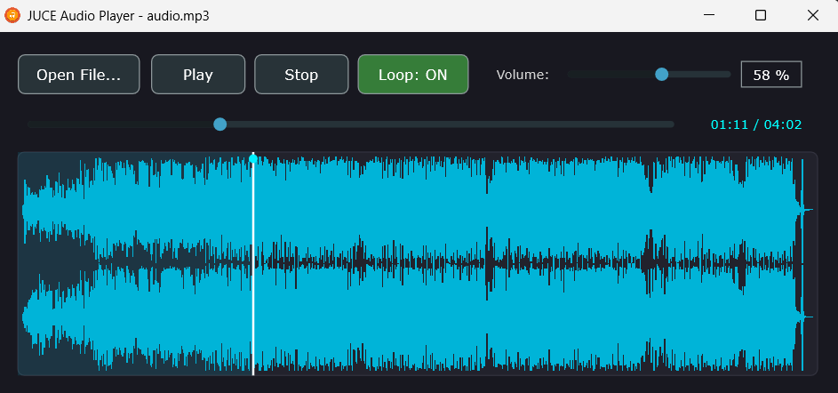

# JUCE Audio Player

A high-performance, modern cross-platform audio player desktop application built with C++17, **JUCE**, and hardware-accelerated decoding.



---

## 🎧 User Guide (User Perspective)

### Quick Start
1. Run `JUCE Audio Player.exe` located in `build/AudioPlayerApp_artefacts/Release/`.
2. Press <kbd>O</kbd> or click **Open File...** to select any audio file.
3. The selected track **automatically begins playing**, and the application title bar updates to show the loaded file name.

---

### Features & Controls Overview

- **Dynamic Window Title**: The active track name appears cleanly in the native window title bar (`JUCE Audio Player - <filename>`) rather than cluttering the playback controls.
- **Auto-Play on Open**: Selecting a new file immediately loads and starts playback without requiring an extra click on Play.
- **Smart Folder Memory**: Opening a file remembers your last media directory, so subsequent file selections open straight to your music folder.
- **Play & Pause Toggle**:
  - Clicking **Play** starts or resumes playback and transitions the button label to **Pause**.
  - Clicking **Pause** pauses audio at the exact current position. Clicking **Play** resumes seamlessly from where it stopped.
- **Stop & Reset**:
  - The **Stop** button remains accessible whenever a file is loaded.
  - Pressing **Stop** immediately halts playback, rewinds the seekbar slider and the waveform playhead to the beginning (`00:00`), and resets the play button.
- **Interactive Audio Waveform Graph (Seek & Scrub)**:
  - Renders a multi-channel audio waveform with a highlighted playback region, progress line, and playhead handle.
  - **Click or drag** anywhere across the waveform graph to instantly seek and scrub through the track with zero latency.
- **Dedicated Seekbar Slider**:
  - Smooth horizontal slider synchronized with the current playback position and the live `MM:SS / MM:SS` time readout.
- **Seamless Loop Toggle**:
  - Click the **Loop** button or press <kbd>L</kbd> to toggle between `Loop: OFF` and `Loop: ON`.
  - When enabled, reaching the end of the track automatically restarts playback from `00:00` without gaps.
- **Mouse Wheel Volume Control & Numeric Display**:
  - Scroll the mouse wheel up or down **anywhere in the application window** to adjust the volume in smooth `±5%` steps.
  - The volume slider features a live numeric percentage indicator (e.g., `80 %`).

---

### Keyboard Shortcuts

| Shortcut | Action | Description |
| :--- | :--- | :--- |
| <kbd>Spacebar</kbd> | **Play / Pause** | Toggle playback state instantly |
| <kbd>O</kbd> / <kbd>o</kbd> | **Open File...** | Open file dialog in the last selected folder |
| <kbd>L</kbd> / <kbd>l</kbd> | **Loop Toggle** | Switch loop mode between ON and OFF |
| <kbd>Mouse Wheel Up</kbd> | **Volume Up** | Increases audio volume by `+5%` |
| <kbd>Mouse Wheel Down</kbd> | **Volume Down** | Decreases audio volume by `-5%` |
| <kbd>Mouse Click / Drag</kbd> | **Seek / Scrub** | Click or drag on the waveform or seekbar to seek |

---

### Supported Audio Formats

| Format | Extension | Decoder Engine |
| :--- | :--- | :--- |
| **WAV** | `.wav` | JUCE Native Uncompressed Codec |
| **MP3** | `.mp3` | DrMp3 Engine + JUCE Fallback |
| **FLAC** | `.flac` | JUCE Native Lossless FLAC Codec |
| **AAC** | `.aac` | Windows Media Foundation + FAAD2 ADTS Engine |
| **M4A** | `.m4a` | Windows Media Foundation + FAAD2 Engine |
| **OGG / Vorbis** | `.ogg` | JUCE OggVorbis Codec |
| **AIFF** | `.aif`, `.aiff` | JUCE Native AIFF Codec |

---

## 🛠️ Developer Guide (Developer Perspective)

### Project Architecture & Directory Layout

The codebase is organized into clean, modular directories separation of concerns:

```text
AudioPlayerApp/
├── .zed/                     # Zed editor configuration & tasks
│   ├── settings.json         # Editor formatting & clangd LSP settings
│   └── tasks.json            # Preconfigured build & run tasks
├── src/                      # Application entry point & GUI components
│   ├── Main.cpp              # Application lifecycle, DocumentWindow & icon setup
│   ├── MainComponent.h       # UI component declarations & audio transport state
│   └── MainComponent.cpp     # Audio rendering, paint logic, events & shortcuts
├── lib/                      # Audio decoders & custom format implementations
│   ├── AacAudioFormat.h      # AAC / M4A AudioFormat wrapper
│   ├── AacAudioFormat.cpp    # WMF (IMFSourceReader) & FAAD2 decoders
│   ├── DrMp3AudioFormat.h    # High-performance MP3 AudioFormatReader
│   └── dr_mp3.h              # Single-header embedded MP3 decoder
├── res/                      # Assets & Resources
│   ├── player.webp           # Application icon (embedded in .exe & title bar)
│   └── app.png               # Application screenshot for documentation
├── JUCE/                     # JUCE Framework submodule
├── CMakeLists.txt            # Modern CMake build script
├── compile_commands.json     # Clangd compilation database
└── README.md                 # Project documentation
```

---

### Key Architectural Components

1. **Window Title & Decoupled State**:
   - [`src/MainComponent`](file:///c:/Users/Amran/dev/AudioPlayerApp/src/MainComponent.h) manages audio playback and signals track updates via the `std::function<void(const juce::String&)> onTitleChange` callback.
   - [`MainWindow`](file:///c:/Users/Amran/dev/AudioPlayerApp/src/Main.cpp) subscribes to this callback and updates the native title bar via `DocumentWindow::setName()`.

2. **Dual-Engine AAC / M4A Decoding**:
   - Implemented in [`lib/AacAudioFormat.cpp`](file:///c:/Users/Amran/dev/AudioPlayerApp/lib/AacAudioFormat.cpp).
   - On Windows, it leverages **Windows Media Foundation** (`IMFSourceReader`) to decode AAC/M4A streams directly into memory with zero latency and hardware efficiency.
   - For standalone ADTS AAC streams or non-WMF platforms, it seamlessly falls back to **FAAD2** (`libfaad`).
   - Decoded samples are stored in an in-memory `AudioBuffer<float>`, enabling instantaneous $O(1)$ seeking, thumbnail generation, and gapless looping.

3. **MP3 Fast Decoding**:
   - Implemented in [`lib/DrMp3AudioFormat.h`](file:///c:/Users/Amran/dev/AudioPlayerApp/lib/DrMp3AudioFormat.h) using David Reid's `dr_mp3` library.
   - If an atypical MP3 format fails initialization, JUCE's registered formats automatically step in as fallbacks.

4. **Embedded Icons & Resources**:
   - The desktop icon is registered via `ICON_BIG "res/player.webp"` in `CMakeLists.txt`, compiled into a native `.ico` resource using `juceaide winicon` and embedded into the Windows PE binary (`AudioPlayerApp_resources.rc`).
   - The runtime title bar and taskbar icon is packed into `AudioPlayerResources` via `juce_add_binary_data` and loaded as `BinaryData::player_webp`.

---

### Building from Source

#### Prerequisites
- **CMake** $\ge$ 3.15
- **C++17 Compiler** (Clang / LLVM with Ninja, or MSVC)
- **Windows Media Foundation SDK** (`mfplat.lib`, `mfreadwrite.lib`, `mfuuid.lib` included with Windows SDK)

#### Build Instructions (Ninja / Clang)
```pwsh
# 1. Clone repository with submodules
git clone --recursive <repository-url>
cd AudioPlayerApp

# 2. Configure with CMake
cmake -B build -G Ninja -DCMAKE_BUILD_TYPE=Release

# 3. Build executable
cmake --build build --config Release
```

The resulting executable will be in:
`build/AudioPlayerApp_artefacts/Release/JUCE Audio Player.exe`

---

### Zed Editor Integration

The project includes first-class support for the [Zed Editor](https://zed.dev):

- **LSP & Auto-completion**: `.zed/settings.json` configures `clangd` to read `build/compile_commands.json` (exported automatically via `set(CMAKE_EXPORT_COMPILE_COMMANDS ON)`).
- **Tasks**: `.zed/tasks.json` provides quick-action shortcuts:
  - `Build Release`: Runs `cmake --build build --config Release`
  - `Run Audio Player`: Launches the compiled `.exe`
  - `Clean Build`: Runs `cmake --build build --target clean`
